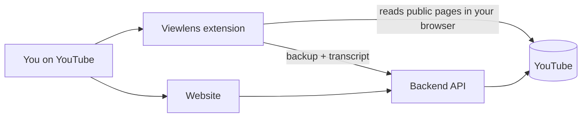

# YT Downloader + Viewlens

Understand any YouTube video in seconds: how much it probably earned, which moments people rewatch, how it compares with the channel, what viewers are saying, and where it is heading next.

**[Open the website](https://yt-downloader-web-pi.vercel.app)** · **[Download the Viewlens extension](https://github.com/Aman-kumar-git12/YtDownloaderWeb/releases/latest/download/viewlens.zip)** · **[Backend repo](https://github.com/Aman-kumar-git12/YtDownloaderBackend)**

---

## What's in this project

| Part | What it does | Where |
| --- | --- | --- |
| **Website** | Paste a YouTube link to see its details and insights, and download the video, audio, thumbnail or subtitles | `src/` (this repo) |
| **Viewlens** (Chrome extension) | Click the icon on any YouTube video to see analytics, hidden details and predictions | `extension/` (this repo) |
| **Backend** (API server) | Fetches video data with yt-dlp, runs downloads and calculates insights | [YtDownloaderBackend](https://github.com/Aman-kumar-git12/YtDownloaderBackend) |



## Viewlens extension

Viewlens opens as a small popup on any YouTube video. It has four tabs:

| Tab | What you see |
| --- | --- |
| **Analytics** | What stands out, estimated earnings, most-replayed moments (click to jump), channel comparison, engagement, search score, comment mood, transcript topics |
| **Details** | Exact views, likes, comments, upload date, quality, description, chapters, tags, caption languages |
| **Hidden** | Things YouTube knows but doesn't show: loudness, planned ad breaks, paid promotion, exact upload time, stream quality, sponsor segments, estimated dislikes |
| **Predictions** | Views in 7 days / 30 days / 1 year, next milestones, breakout chance, earnings ahead, the creator's next upload and a fair sponsor price |

Two buttons sit at the top right:
- **skip ad** skips the YouTube ad that's playing (presses YouTube's Skip button, or jumps to the end of an ad that can't be skipped yet). With no ad playing, it jumps past the sponsor read, intro or "subscribe" reminder the video is in (from SponsorBlock).
- **dwnld** opens the website with the current video filled in.

### Install it (free)

1. [Download `viewlens.zip`](https://github.com/Aman-kumar-git12/YtDownloaderWeb/releases/latest/download/viewlens.zip) and unzip it. Keep the folder.
2. Open `chrome://extensions` (also works in Edge and Brave).
3. Turn on **Developer mode** (top right).
4. Click **Load unpacked** and choose the unzipped folder.
5. Open any YouTube video and click the Viewlens icon. Pin it from the 🧩 menu.

**To update:** download the new zip, replace the folder, then click ↻ on Viewlens in `chrome://extensions`.

## Website

1. Paste a YouTube link.
2. See the video's details and the **Insights** tab.
3. Pick a format (video, audio, thumbnail or subtitles), optionally clip a part, and download it.

Downloads run on the server as background jobs with a live progress bar. Each file is deleted from the server right after you receive it.

## How it works (simply)

- **Real data** (views, likes, tags, chapters…) comes straight from YouTube's public pages.
- **Estimates** (earnings, audience countries, forecasts) are worked out with clear formulas and always shown as a **range**. Only a channel's owner can see its real earnings.
- **Predictions** use the way views usually grow: fast at first, then slower. The curve is fitted to each channel's own recent uploads when the data supports it.
- **The extension reads YouTube in your own browser,** so it keeps working even when YouTube blocks the server. The server is only a backup, plus the transcript.

Every number in the app is labelled **Real data** or **Estimate**.

## Project structure

```
.
├── src/                  # Website (React)
│   ├── components/       # UI pieces: video summary, formats, clip picker, insights cards
│   ├── lib/              # Formatting, highlights, creator sign-in
│   └── api.js            # Calls to the backend
├── extension/            # Viewlens Chrome extension (no build step)
│   ├── popup.html/js/css # The popup and its four tabs
│   ├── background.js     # Keeps the server awake while you're on YouTube
│   ├── lib/              # Reads YouTube, calculates insights and predictions
│   ├── PRIVACY.md        # What the extension reads and sends
│   └── README.md         # Extension details
├── scripts/              # Builds the extension zip
└── public/               # Icons and app manifest
```

## Run it locally

You need **Node.js 20+**, plus the [backend](https://github.com/Aman-kumar-git12/YtDownloaderBackend) running for the website.

```bash
npm install
cp .env.example .env        # set VITE_API_BASE_URL to your backend
npm run dev                 # http://localhost:5173
```

| Command | What it does |
| --- | --- |
| `npm run dev` | Start the website with live reload |
| `npm run build` | Build the website into `dist/` |
| `npm run lint` | Check the code |
| `npm run package:extension` | Build `viewlens.zip` for a GitHub release |

**Extension while developing:** in `chrome://extensions`, choose **Load unpacked** → the `extension/` folder. Click ↻ after each change.

<details>
<summary><b>Optional: "Your real numbers" (creator sign-in)</b></summary>

Channel owners can sign in with Google to see their real earnings, countries and watch time. Set `VITE_GOOGLE_CLIENT_ID` with a Google OAuth client that has the YouTube Data API v3 and YouTube Analytics API enabled, and your site's URL as an authorised origin. Sign-in happens only in the browser, and the token never reaches the backend.
</details>

## Tech stack

**Website:** React 19, Vite, Tailwind CSS, Framer Motion · **Extension:** plain JavaScript, Chrome Manifest V3 · **Backend:** Python, FastAPI, yt-dlp, FFmpeg · **Hosting:** Vercel (website), Render (backend), GitHub Releases (extension)

## Privacy

Viewlens has no accounts, no tracking and no ads. It reads only public YouTube data for the video you open. See [`extension/PRIVACY.md`](extension/PRIVACY.md) for exactly what is read and where it goes.

## Disclaimer

For personal and educational use. Downloading from YouTube may break its Terms of Service, so only download content you have the right to. Earnings, audience and prediction figures are estimates, not official YouTube numbers.

---

Made by **[Aman Kumar](https://github.com/Aman-kumar-git12)**
